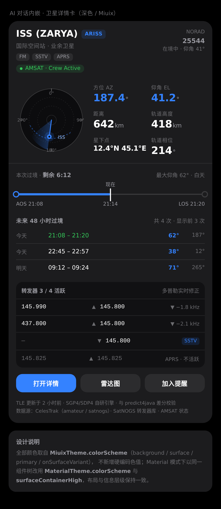
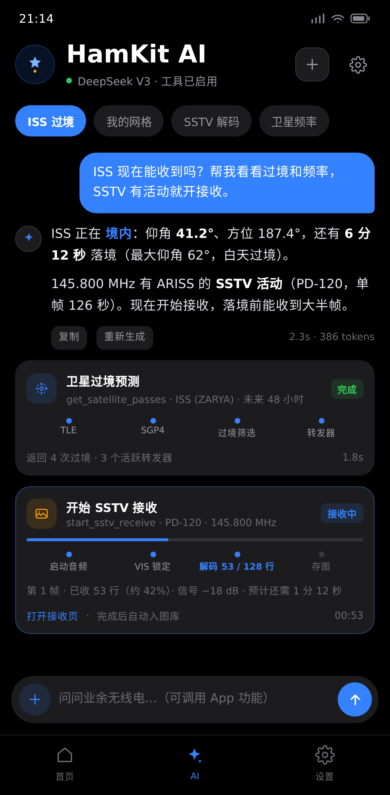
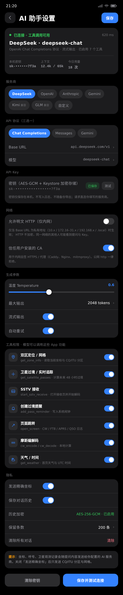

# HamKit AI 助手接入调研与设计方案

> 调研日期：2026-10-30
> 目标分支：`miuix`（当前 HEAD `a6062fa`）
> 结论定位：**调研 + 可执行设计**。P0 已于 2026-10-31 落地（commit `7a21720`）：三协议流式对话、Keystore 加密、导航第 3 项；工具调用与卫星卡片为 P1。
> 设计稿：`docs/mockups/ai/shots/`（源码为同目录 `.html`）

---

## 0. 结论速览

| 项 | 结论 |
|---|---|
| 交互形态 | 底部导航新增第 3 个页签 **AI**（首页 / AI / 设置），pager 内嵌，不单独开 Activity |
| 协议 | 一套适配层支持 **3 种**：OpenAI Chat Completions、Anthropic Messages、Google Gemini（`streamGenerateContent?alt=sse`） |
| 默认预设 | **DeepSeek**：`https://api.deepseek.com/v1` + `deepseek-chat`（OpenAI 兼容，支持工具调用）；其余预设可一键切换 |
| 能力 | 纯知识问答 + **14 个本地工具**（双区定位、卫星过境/实时/转发器/AMSAT、SSTV 接收、页面跳转、提醒、摩斯编解码、天气/UTC） |
| 富内容 | 工具结果分两条通道：给模型的紧凑 JSON、给 UI 的结构化卡片（卫星卡、SSTV 进度卡、图片卡） |
| 进度 | 工具卡内嵌 `LinearProgressIndicator`（分阶段 determinate / 网络等待 indeterminate），长任务可取消、可超时 |
| 密钥 | 用户自带 API Key，**Android Keystore AES-GCM** 加密后存本地；不硬编码、不进日志、不随备份导出 |
| 内网 | 支持内网 http/https：系统层放开明文 + **业务层白名单**（仅 AI Base URL 的私有地址），默认关闭、开启需确认 |
| 历史 | 会话与索引 **AES-GCM 加密**（独立 Keystore 密钥）、原子写入；导出默认明文但需二次确认 |
| 主题 | 严格复用 `MiuixTheme.colorScheme` / `MaterialTheme.colorScheme` 与既有组件，禁止自创配色（设计稿已按真实主题重绘） |
| 工作量 | P0 基础对话 5–7 人日；P1 工具 + 卫星卡 5–6 人日；P2 联动与打磨 4–5 人日 |

**三个最关键的工程判断**：

1. **必须做"协议 → 统一事件流"的适配层**，否则三种协议的流式差异（尤其工具参数增量）会渗透进 UI 与对话状态机，后面每加一个供应商就要改一遍。
2. **工具结果不能只回文本**。卫星信息要"详细好看"，就必须由 Compose 渲染结构化卡片；若把卡片 HTML/长文本塞进上下文，既贵又容易被模型改写。
3. **`MarkdownContent` 是 WebView**，逐 token 重载会闪、会卡；流式阶段用原生 `Text`，`Done` 后一次性渲染 Markdown。

---

## 1. 需求拆解

### 1.1 用户故事

| 编号 | 角色 | 故事 | 验收要点 |
|---|---|---|---|
| U1 | 爱好者 | 问"业余无线电 CQ 分区怎么划分""FT8 的 73 是什么意思" | 正常多轮问答，中文/英文都行，支持 Markdown 与代码块 |
| U2 | 爱好者 | 问"我现在在哪个网格""CQ 几区" | 调用 `get_zone_info`，返回纬度/经度/CQ/ITU/Maidenhead/地址，并显示定位卡 |
| U3 | 爱好者 | 问"ISS 明天几点过境，用什么频率" | 调用 `get_satellite_passes` + `get_satellite_transmitters`，渲染卫星详情卡 |
| U4 | 爱好者 | 问"ISS 现在能收到吗" | 调用 `get_satellite_live`，显示 AZ/EL/距离/多普勒/蚀状态，1 Hz 刷新 |
| U5 | 爱好者 | 说"打开 SSTV 接收 ISS" | 调用 `start_sstv_receive`，跳转 SSTV 页并自动开始，AI 页显示跨页面进度 |
| U6 | 爱好者 | 说"给我设个 ISS 明早过境的提醒" | 调用 `add_pass_reminder`，写入系统闹钟，返回提醒卡 |
| U7 | 新用户 | 第一次进 AI 页，没配 Key | 显示引导卡与"去配置"，不发起任何网络请求 |
| U8 | 用户 | 配置了错误 Key | 错误分类明确（401），可一键去设置；不泄露 Key 到日志 |

### 1.2 功能边界

**做**：
- 业余无线电知识、操作规范、卫星/模式/频率常识（模型自身知识 + App 内数据工具）
- 读取 App 内已有数据（定位、TLE 缓存、转发器库、AMSAT 状态、图库、CW 设置）
- 触发 App 内动作（导航、开始 SSTV 接收、创建提醒）
- 对结果做"卡片化"展示，卡片可继续跳转详情页

**不做（本期）**：
- 不做联网搜索（无搜索服务预算，且会引入内容合规问题；见 §9 开放问题）
- 不做云端会话（会话只在本机）
- 不做语音播报（语音输入可选，见 §9）
- 不让模型直接发射（TX）、不自动改设置、不自动删除数据
- 不做服务端代理（Key 直连供应商，用户自担配额）

### 1.3 非功能要求

| 维度 | 要求 |
|---|---|
| 首字延迟 | 流式首 token ≤ 3 s（正常网络） |
| 工具耗时 | 纯本地 ≤ 300 ms；卫星预测 ≤ 5 s；SSTV 接收为长任务（跨页面） |
| 内存 | 单会话上下文 ≤ 24 条有效轮次；工具结果 ≤ 4 KB/条 |
| 兼容 | Android 8.0+（minSdk 26），与现有 `miuix` 分支一致 |
| 双风格 | Miuix / Material 两套实现共用同一 ViewModel（`docs/UI_STYLE_PARITY.md` 约定） |
| 多语言 | 默认英文 + `values-zh-rCN`，其余语言回退英文 |
| 无障碍 | 流式内容使用 `liveRegion = Polite`；进度条有 `contentDescription` |

---

## 2. 现状盘点（代码级）

### 2.1 导航与主界面

| 现状 | 位置 | 对 AI 页的影响 |
|---|---|---|
| 底部导航只有 2 项：`Home` / `Setting` | `ui/component/bottombar/BottomBar.kt` 的 `BottomBarDestination` | 需新增第 3 项，Miuix/Material/Rail 四处同步 |
| `MainPagerConfig.PAGE_COUNT = 2` | `ui/viewmodel/MainActivityViewModel.kt` | 改为 3，并做**索引迁移**（旧 1=设置 → 新 2） |
| `MainScreen` 里 `when (page) { 0 -> Home; 1 -> Setting }` | `ui/MainActivity.kt` | 新增 `1 -> AI; 2 -> Setting` |
| 选中页存 `SavedStateHandle`（非 SharedPreferences） | `MainActivityViewModel.kt` | 仅进程/系统恢复会带旧索引，迁移一次即可 |
| 子页路由是 `Route` sealed interface | `ui/navigation3/Routes.kt` | 新增 `Route.AiSettings`；AI 主页面不需要新 Route（在 pager 内） |
| 每个 NavDisplay entry 有独立 ViewModelStore | `MainActivity.kt` `WithApplicationViewModelStoreOwner` | AI 页在 pager 内，用 `appViewModel<AiAssistantViewModel>()` 保证切页不中断请求 |
| 返回键：子页出栈 → 主页面回第 0 页 → 退出 | `RootBackHandler` / `MainScreenBackHandler` | 不改逻辑，但第 0 页仍是首页，AI 页返回会回首页（符合预期） |

### 2.2 双风格约定（硬约束）

`docs/UI_STYLE_PARITY.md` 明确：**对外只暴露一个函数，内部按 `LocalUiMode` 分发**；两种风格必须共用同一个 ViewModel。AI 页属于"大页面、交互多"，按写法 B 分文件：

```
AiAssistantScreen.kt          // 分发入口 + Miuix 实现
AiAssistantMaterial.kt        // Material 实现（参数列表完全一致）
```

组件级同样要分：`AiToolCard`、`AiSatelliteCard`、`AiProgressBar` 各写两套私有实现，参数用同一套 data class。

### 2.3 可复用的能力（工具的真实来源）

| 能力 | 入口 | 数据结构 | 可否后台调用 |
|---|---|---|---|
| 定位 + 分区 | `MainViewModel.locationState`、`ZoneResolver`、`MaidenheadCalculator` | `LocationResult(lat, lon, cqZone, ituZone, maidenhead, address)` | 需主线程触发 `refreshLocation()`，再等状态 |
| 卫星预测（48 h） | `MainViewModel.satelliteState.satellites`（缓存）、`SatellitePredictor.predictUpcomingPasses()` | `SatelliteInfo(name, catnum, aos, los, maxEl, az, isVisible, status, isGeo, isDaylightPass)` | 是（`Dispatchers.Default`） |
| TLE 缓存 | `SatelliteCacheStore`、`satelliteState.cachedTles` | `SourcedTLE` | 是（IO） |
| 实时追踪 | `LiveSatelliteTracker`（1 Hz）、`SatelliteLiveInfo` | AZ/EL/距离/距离变化率/高度/星下点/相位/蚀/日月/多普勒 | 是（`start/stop`） |
| 转发器库 | `MainViewModel.radioMap`、`RadioInfoRepository`（SatNOGS） | `RadioInfo(norad, name, uplinkHz, downlinkHz, mode, inverted, status, description)` | 是（本地缓存 + 网络刷新） |
| AMSAT 状态 | `MainViewModel.statusTracker.queryStatus(name)` | `SatelliteStatusQuery` / `SegmentStatus` | 是 |
| SSTV 接收/解码 | `SstvViewModel.startReceiving()`、`SstvUiState(decodedLines, totalLines, mode, bitmap)` | 应用级单例 VM（`applicationScopedViewModel`） | 是（长任务，跨页面观察） |
| SSTV 图库 | `SstvImageStore.list()` / `Entry` | 文件 + 缩略图 | 是（IO） |
| 过境提醒 | `MainViewModel.toggleSatelliteReminder()` / `ReminderStore` | AlarmManager + WorkManager | 需主线程（写闹钟） |
| CW 编解码 | `MorseCodeGenerator` | 文本 ↔ 摩斯 | 是（纯函数） |
| 天气/UTC | `MainViewModel.weather`、`HomeViewModel` | 温度/天气/UTC 时间 | 是（缓存） |

> 关键点：**工具不重写业务逻辑**，只编排现有 ViewModel / Repository。这样工具行为与页面行为天然一致，测试也能复用既有单测。

### 2.4 网络与存储底座

| 项 | 现状 | 对 AI 接入的影响 |
|---|---|---|
| HTTP | `HttpClientProvider.client`（OkHttp 5.3.2，连接 15 s / 读 30 s） | 流式必须 `readTimeout(0)` 派生新 client，不能改全局 |
| JSON | `org.json`（无 kotlinx-serialization-json 依赖） | 协议解析用 `JSONObject`；**禁止新增依赖**，解析器要能吃任意空白/多行 SSE |
| 设置存储 | `SharedPreferences("settings")`；CW 用 DataStore | AI 配置建议独立 `SharedPreferences("ai_settings")`，密钥单独加密存储 |
| 数据库 | Room 2.7（APRS、QSO） | 会话历史**优先 JSON 文件**，避免 Room schema 迁移（见 §7） |
| 备份 | `android:allowBackup="false"`、`data_extraction_rules` | Key 与对话天然不随备份；仍需显式说明 |
| 明文网络 | `network_security_config.xml` 仅允许 localhost 明文 | 内网支持需在 manifest 层放开明文、再用业务层白名单收窄（见 §6.2）；默认仍只走 https |
| 多语言 | 默认英文 + 50+ 个 `values-*` | 新字符串只需加 `values` + `values-zh-rCN`，其余回退 |
| 权限 | 已有定位、录音、通知、精确闹钟 | 工具不需要新权限；但"发送坐标"要有开关 |

### 2.5 隐私与合规现状

- 首启有 `PrivacyConsentScreen`（`PrivacyConsentStore`），同意前不创建业务 VM、不初始化高德 SDK。
- 隐私政策为离线 HTML：`assets/privacy_policy_zh.html` / `privacy_policy_en.html`。
- 已明确"客户端拿到的 Key 不是秘密"（`docs/CRYPTO_DESIGN.md`）——**但用户自带的第三方 API Key 不同**：它代表用户的付费额度，必须按秘密处理。

**AI 接入后的变化必须写进隐私政策**：
1. 对话内容、可能包含的坐标/呼号/卫星记录会发送到**用户自己配置的**第三方 AI 服务商；
2. App 不经过开发者服务器，无法代用户删除第三方侧数据；
3. Key 仅存本机、加密保存、不写日志；
4. 关闭"发送精确坐标"后只发送 CQ/ITU/网格。

### 2.6 缺口清单

| 缺口 | 说明 | 处理 |
|---|---|---|
| 无流式 HTTP 经验 | 现有服务全是 `execute()` 一次性读取 | 新增 `SseReader`，派生无读超时 client |
| 无 JSON Schema 生成 | 工具参数 schema 手写 | 每个工具手写 `JSONObject` schema + 单测校验 |
| 无 Markdown 流式渲染 | WebView 重载成本高 | 流式纯文本，完成后再 Markdown |
| 无跨页面任务 UI | SSTV 是独立页面 | AI 页观察 `SstvViewModel.uiState` 显示进度卡 |
| 无 Key 加密存储 | 现有 Key 都是"非秘密" | 新增 `AiKeyStore`（Keystore AES-GCM） |
| 无会话存储 | 无 | JSON 文件 + 索引 |

---

## 3. 三种 API 协议调研

### 3.1 选型与理由

| 方案 | 协议组合 | 优点 | 缺点 | 结论 |
|---|---|---|---|---|
| **A（推荐）** | OpenAI Chat Completions + Anthropic Messages + Gemini | 覆盖 OpenAI/DeepSeek/Kimi/GLM/Qwen/OpenRouter（均兼容 OpenAI）+ Claude + Gemini；国内可用的三家都在 | 三套流式解析 | ✅ 采用 |
| B | OpenAI Chat Completions + OpenAI Responses + Anthropic | Responses 事件模型更现代（`response.*` 事件） | 国内几乎没有兼容实现；与 Chat Completions 高度重叠，收益低 | ❌ |
| C | 只做 OpenAI 兼容 | 实现最省 | 用不了 Claude/Gemini 原生 Key；用户群受限 | ❌ |

> 说明：**OpenAI 兼容层是事实标准**。DeepSeek、Kimi（Moonshot）、智谱 GLM、通义千问（DashScope compatible-mode）、硅基流动、OpenRouter 都提供 `/chat/completions`。因此第一种协议定为 Chat Completions，而不是 Responses。后续若要加 Responses，只需新增一个 `AiProtocolClient` 实现（接口见 §3.5）。

### 3.2 请求 / 流式 / 工具回传对照

| 维度 | OpenAI Chat Completions | Anthropic Messages | Google Gemini |
|---|---|---|---|
| 端点 | `POST {base}/chat/completions` | `POST {base}/v1/messages` | `POST {base}/v1beta/models/{model}:streamGenerateContent?alt=sse` |
| 鉴权 | `Authorization: Bearer <key>` | `x-api-key: <key>` + `anthropic-version: 2023-06-01` | `x-goog-api-key: <key>` |
| 系统提示 | `messages[0] = {role:"system"}` | 顶层 `system: "..."`（字符串或 block 数组） | `systemInstruction: {parts:[{text}]}` |
| 消息角色 | `system/user/assistant/tool` | `user/assistant`（工具结果也是 user） | `user/model`（工具结果放 user 或 function） |
| 工具声明 | `tools:[{type:"function", function:{name,description,parameters}}]` | `tools:[{name,description,input_schema}]` | `tools:[{functionDeclarations:[{name,description,parameters}]}]` |
| 工具选择 | `tool_choice: "auto"` | `tool_choice: {type:"auto"}` | `toolConfig.functionCallingConfig.mode:"AUTO"` |
| 流式格式 | SSE，`data: {chunk}`，结束 `data: [DONE]` | SSE，带 `event:` 名的事件流 | SSE（`alt=sse`），`data: {GenerateContentResponse}` |
| 文本增量 | `choices[0].delta.content` | `content_block_delta` → `text_delta.text` | `candidates[0].content.parts[].text` |
| 工具增量 | `choices[0].delta.tool_calls[i].function.arguments`（**字符串增量**） | `content_block_delta` → `input_json_delta.partial_json` | 通常**一次性**给完整 `functionCall.args`（对象） |
| 结束信号 | `finish_reason: stop / tool_calls / length` | `message_delta.stop_reason: end_turn / tool_use / max_tokens` | `finishReason: STOP / MAX_TOKENS / MALFORMED_FUNCTION_CALL` |
| 工具回传 | `{role:"tool", tool_call_id, content}` | `{role:"user", content:[{type:"tool_result", tool_use_id, content}]}` | `{role:"user", parts:[{functionResponse:{name, response}}]}` |
| 多工具 | 同一轮 `tool_calls[]` 多个 | 多个 `tool_use` block | 多个 `functionCall` parts |
| 用量 | `usage.{prompt_tokens,completion_tokens}`（需 `stream_options.include_usage`） | `message_start.message.usage` + `message_delta.usage` | `usageMetadata.{promptTokenCount,candidatesTokenCount}` |
| 错误体 | `{"error":{"message","type","code"}}` | `{"type":"error","error":{"type","message"}}` | `{"error":{"code","message","status"}}` |
| 思考内容 | `delta.reasoning_content`（DeepSeek 等） | `thinking_delta`（需开启 thinking） | `part.thought: true` |

### 3.3 三种协议的工具调用示例

**OpenAI Chat Completions（流式）**

```jsonc
// 请求
{
  "model": "deepseek-chat",
  "messages": [
    {"role": "system", "content": "你是 HamKit 助手……"},
    {"role": "user", "content": "ISS 明天几点过境？"}
  ],
  "tools": [{
    "type": "function",
    "function": {
      "name": "get_satellite_passes",
      "description": "计算指定卫星未来若干小时的过境",
      "parameters": {
        "type": "object",
        "properties": {
          "satellite": {"type": "string", "description": "卫星名称或 NORAD 编号"},
          "hours": {"type": "integer", "minimum": 1, "maximum": 72, "default": 48}
        },
        "required": ["satellite"]
      }
    }
  }],
  "tool_choice": "auto",
  "stream": true,
  "stream_options": {"include_usage": true}
}

// 响应片段
data: {"choices":[{"index":0,"delta":{"tool_calls":[{"index":0,"id":"call_1","type":"function","function":{"name":"get_satellite_passes","arguments":"{\"sat"}}]},"finish_reason":null}]}
data: {"choices":[{"index":0,"delta":{"tool_calls":[{"index":0,"function":{"arguments":"ellite\":\"ISS\",\"hours\":24}"}}]},"finish_reason":"tool_calls"}]}
data: [DONE]

// 回传
{"role":"assistant","content":null,"tool_calls":[{"id":"call_1","type":"function","function":{"name":"get_satellite_passes","arguments":"{\"satellite\":\"ISS\",\"hours\":24}"}}]}
{"role":"tool","tool_call_id":"call_1","content":"{\"passes\":[{\"aos\":\"2026-10-31T01:12:00+08:00\",...}]}"}
```

**Anthropic Messages（流式）**

```jsonc
// 请求
{
  "model": "claude-sonnet-4-5",
  "max_tokens": 2048,
  "system": "你是 HamKit 助手……",
  "messages": [{"role": "user", "content": "ISS 明天几点过境？"}],
  "tools": [{
    "name": "get_satellite_passes",
    "description": "……",
    "input_schema": {"type": "object", "properties": {"satellite": {"type": "string"}}, "required": ["satellite"]}
  }],
  "stream": true
}

// 响应事件（节选）
event: message_start
data: {"type":"message_start","message":{"id":"msg_1","role":"assistant","content":[],"usage":{"input_tokens":520,"output_tokens":1}}}

event: content_block_start
data: {"type":"content_block_start","index":0,"content_block":{"type":"tool_use","id":"toolu_1","name":"get_satellite_passes","input":{}}}

event: content_block_delta
data: {"type":"content_block_delta","index":0,"delta":{"type":"input_json_delta","partial_json":"{\"satellite\":\"ISS\"}"}}

event: content_block_stop
data: {"type":"content_block_stop","index":0}

event: message_delta
data: {"type":"message_delta","delta":{"stop_reason":"tool_use"},"usage":{"output_tokens":42}}

// 回传：assistant 的 content blocks 要原样带回，再补 user/tool_result
{"role":"assistant","content":[{"type":"tool_use","id":"toolu_1","name":"get_satellite_passes","input":{"satellite":"ISS"}}]}
{"role":"user","content":[{"type":"tool_result","tool_use_id":"toolu_1","content":"{\"passes\":[...]}"}]}
```

**Gemini（流式）**

```jsonc
// 请求
{
  "systemInstruction": {"parts": [{"text": "你是 HamKit 助手……"}]},
  "contents": [{"role": "user", "parts": [{"text": "ISS 明天几点过境？"}]}],
  "tools": [{
    "functionDeclarations": [{
      "name": "get_satellite_passes",
      "description": "……",
      "parameters": {"type": "object", "properties": {"satellite": {"type": "string"}}, "required": ["satellite"]}
    }]
  }],
  "toolConfig": {"functionCallingConfig": {"mode": "AUTO"}},
  "generationConfig": {"temperature": 0.6, "maxOutputTokens": 2048}
}

// 响应片段（alt=sse）
data: {"candidates":[{"content":{"role":"model","parts":[{"text":"我查一下。"}]},"finishReason":"STOP"}],"usageMetadata":{"promptTokenCount":480}}

data: {"candidates":[{"content":{"role":"model","parts":[{"functionCall":{"name":"get_satellite_passes","args":{"satellite":"ISS"}}}]},"finishReason":"STOP"}]}

// 回传
{"role":"user","parts":[{"functionResponse":{"name":"get_satellite_passes","response":{"result":"{\"passes\":[...]}"}}}]}
```

### 3.4 兼容性坑（实测清单）

| # | 坑 | 影响 | 处理 |
|---|---|---|---|
| 1 | OpenAI 兼容服务把 `arguments` 一次性给全，而非增量 | 增量拼接后仍是完整 JSON，**只要用"追加"语义就不会错** | 统一 accumulate 字符串，最后 `JSONObject` 校验 |
| 2 | 部分服务 `finish_reason` 为 `tool_calls` 但 `delta` 为空 | 漏执行工具 | 以 `accumulatedToolCalls` 是否非空为准，不只看 finish |
| 3 | Anthropic 要求 messages 严格交替，`tool_result` 必须在紧随的 user 消息中 | 400 invalid_request | 统一消息 → 协议消息时做"合并相邻同角色"与"tool_result 归并" |
| 4 | Gemini 新模型（2.5+/3）的 `functionCall` 可能携带 `thoughtSignature` | 不回传会 400 | 在 `ToolCall.signature` 保存原值并回传 |
| 5 | Gemini 工具结果 role 在 `user` / `function` 间有版本差异 | 400 | 以官方示例为准（`user`），遇到 400 再降级尝试 `function`，做成可配置 |
| 6 | 部分兼容服务不支持 `tools` | 工具永远不触发 | 首次配置时"能力探测"：带 tools 发最小请求，失败则标记 `supportsTools=false` 并提示 |
| 7 | 部分服务不支持流式工具参数 | 工具卡一直转圈 | 收到 `finish` 后强制 flush 未完成的 call |
| 8 | `usage` 缺失 | 无法统计 | 本地估算（字符数 / 3.5），标注"估算" |
| 9 | 思考内容混入正文 | 回答里出现"让我想想…" | `reasoning_content`/`thinking_delta`/`thought` 单独通道，折叠展示 |
| 10 | 空 `content` 用 `""` 还是 `null` | 严格实现 400 | 统一序列化时省略空字段 |
| 11 | 中文/emoji 截断在多字节边界 | 乱码 | SSE 按 `readUtf8Line()` 解码，不自行切片 |
| 12 | 反向代理返回 `text/event-stream; charset=utf-8` | 解析误判 | 只按行首 `data:`/`event:` 解析，不看 Content-Type |

### 3.5 统一抽象

**统一消息模型**（内部唯一表示，协议差异全部收敛到适配器）：

```kotlin
enum class AiRole { SYSTEM, USER, ASSISTANT, TOOL }

sealed interface AiBlock {
    data class Text(val text: String) : AiBlock
    data class ToolCall(
        val id: String,
        val name: String,
        val argsJson: String,
        val signature: String? = null, // Gemini thoughtSignature / Anthropic 未来扩展
    ) : AiBlock
    data class ToolResult(
        val callId: String,
        val content: String,
        val isError: Boolean = false,
    ) : AiBlock
    data class Reasoning(val text: String) : AiBlock
}

data class AiMessage(val role: AiRole, val blocks: List<AiBlock>)
```

**统一流式事件**：

```kotlin
sealed interface AiEvent {
    data class TextDelta(val text: String) : AiEvent
    data class ReasoningDelta(val text: String) : AiEvent
    data class ToolCallStarted(val index: Int, val id: String, val name: String) : AiEvent
    data class ToolArgsDelta(val index: Int, val delta: String) : AiEvent
    data class ToolCallReady(val index: Int, val call: AiToolCall) : AiEvent
    data class Usage(val input: Int?, val output: Int?) : AiEvent
    data class Finished(val stop: AiStopReason) : AiEvent
    data class Failed(val error: AiError) : AiEvent
}

enum class AiStopReason { END_TURN, TOOL_USE, MAX_TOKENS, CONTENT_FILTER, UNKNOWN }
```

**适配器接口**：

```kotlin
interface AiProtocolClient {
    val protocol: AiProtocol

    /** 流式对话；必须支持取消（协程取消时关闭 OkHttp Call）。 */
    fun stream(config: AiConfig, request: AiRequest): Flow<AiEvent>

    /** 配置页"测试连接"：发最小请求，返回延迟与能力探测结果。 */
    suspend fun probe(config: AiConfig): AiProbeResult
}

enum class AiProtocol { OPENAI_CHAT, ANTHROPIC_MESSAGES, GEMINI }
```

**传输层**：流式必须绕开全局 30 s 读超时：

```kotlin
// data/ai/AiHttp.kt
internal object AiHttp {
    // 注意：不要修改 HttpClientProvider.client（其它业务依赖 30s 超时）
    val streaming: OkHttpClient by lazy {
        HttpClientProvider.client.newBuilder()
            .readTimeout(0, TimeUnit.MILLISECONDS) // SSE 长连接
            .connectTimeout(15, TimeUnit.SECONDS)
            .build()
    }
}
```

**SSE 解析器**（三种协议共用，只负责"行 → 事件"）：

```kotlin
// data/ai/SseReader.kt
data class SseFrame(val event: String?, val data: String)

class SseReader(private val lines: LineSource) {   // 可注入，便于单测
    /**
     * 逐帧读取：
     * - 以空行分隔帧；`data:` 可多行，用 \n 拼接
     * - 忽略注释行（":" 开头）与 `event:`/`id:`/`retry:` 之外的字段
     * - 对端关闭时 flush 最后一帧
     */
    suspend fun read(): Sequence<SseFrame>
}
```

> 单测不依赖 MockWebServer（项目未引入该依赖，规则禁止新增）：把 `SseReader` 的输入抽象成 `LineSource`，测试直接喂字符串，覆盖：正常帧、多行 data、`[DONE]`、空行缺失、CRLF、超长行、半帧结束。

**协议消息映射（最容易实现错的部分）**：

| 统一模型 | OpenAI | Anthropic | Gemini |
|---|---|---|---|
| `SYSTEM` | `messages[0].role=system` | 顶层 `system` | `systemInstruction.parts` |
| `USER`(text) | `{role:user,content}` | `{role:user,content:[{type:text,text}]}` | `{role:user,parts:[{text}]}` |
| `ASSISTANT`(text) | `{role:assistant,content}` | `{role:assistant,content:[{type:text,text}]}` | `{role:model,parts:[{text}]}` |
| `ASSISTANT`(toolCall) | `{role:assistant,tool_calls:[...]}` | `{role:assistant,content:[{type:tool_use,...}]}` | `{role:model,parts:[{functionCall,...}]}` |
| `TOOL` | `{role:tool,tool_call_id,content}` | 合并进**下一条 user** 的 `tool_result` | `{role:user,parts:[{functionResponse,...}]}` |

实现时建议"先按统一模型追加，再整体序列化"（而不是边流边拼），避免 Anthropic 的 tool_result 合并把顺序搞乱。

### 3.6 为什么不用 OpenAI Responses API

- 事件模型（`response.output_text.delta`、`response.function_call_arguments.delta`、`response.completed`）确实更适合工具流；
- 但国内兼容层几乎为零，且与 Chat Completions 功能重叠；
- 抽象层已经隔离差异，未来加 Responses 只需一个 `OpenAiResponsesClient`，不影响 UI 与状态机。

---

## 4. 对话与工具调用架构

### 4.1 状态机

```
            ┌──────────── 用户发送 ────────────┐
            ▼                                  │
   [Idle] ──► [Streaming] ──► [AwaitingTools] ─┘（≤5 轮）
                │   ▲              │
                │   └──[ToolRunning]◄── 执行工具（并发/串行）
                │          │
                ▼          ▼
             [Done]     [Error] / [Cancelled]
```

| 状态 | UI 表现 | 可取消 |
|---|---|---|
| `Idle` | 输入可用 | — |
| `Streaming` | 消息尾部打字光标 + "停止"按钮 | 是（取消 OkHttp Call） |
| `AwaitingTools` | 工具卡排队，状态"准备中" | 是 |
| `ToolRunning` | 工具卡进度条 + 阶段文案 + 取消 | 是 |
| `Done` | 消息渲染完成，展示用量/耗时 | — |
| `Error` | 错误卡 + 重试按钮（保留已生成文本） | — |
| `Cancelled` | 保留部分回答，标注"已停止" | 重新发送 |

### 4.2 轮次、超时与重试

| 项 | 值 | 说明 |
|---|---|---|
| 最大工具轮次 | 5 | 防止模型无限调用；超过后强制"总结当前结果" |
| 单次 HTTP | 连接 15 s，读超时流式 0（由心跳/空闲计时兜底） | 空闲 60 s 无数据 → 视为超时 |
| 单工具超时 | 本地 10 s；网络/计算 30 s；SSTV 启动 5 s（之后转为长任务，不阻塞对话） | 超时返回 `isError=true` 的工具结果，让模型解释 |
| 重试 | 仅对网络错误 / 429 / 5xx，指数退避 1 s/2 s，最多 2 次 | 4xx（除 429）不重试 |
| 取消 | 用户点"停止"→ 取消请求 + 取消工具任务；已生成文本保留 | 工具需 cooperative cancel |

### 4.3 上下文与 token 预算

- 保留最近 **24 条**消息（user+assistant+tool），更早的折叠成摘要占位（本期不做自动摘要，直接丢弃并提示）；
- 工具结果回给模型的文本 **≤ 4 KB**：卫星列表最多 8 条、过境最多 6 次、转发器最多 8 个；
- 图片/位图**永不进上下文**（只给 UI）；
- 超长用户输入（> 8 KB）在发送前截断并提示；
- 预算展示：`usage` 有则显示真实值，无则估算。

### 4.4 工具注册表

```kotlin
// data/ai/tool/AiTool.kt
interface AiTool {
    val spec: AiToolSpec

    /** 返回给模型 + 给 UI 的富结果；必须可取消、可上报进度。 */
    suspend fun execute(ctx: AiToolContext, args: JSONObject): ToolOutcome
}

data class AiToolSpec(
    val name: String,                 // snake_case，模型可读
    val title: String,                // 卡片标题（本地化用资源 id）
    val description: String,          // 给模型看，英文
    val parameters: JSONObject,       // JSON Schema
    val category: ToolCategory,       // LOCATION / SATELLITE / SSTV / NAV / UTIL
    val risk: RiskLevel,              // READ_ONLY / SIDE_EFFECT / NAVIGATION
    val longRunning: Boolean = false, // 是否显示 determinate 进度
    val requiresLocation: Boolean = false,
    val enabledByDefault: Boolean = true,
)

/** 工具执行上下文：只暴露必要的 App 能力，禁止工具直接操作 UI 组件。 */
class AiToolContext(
    val app: Application,
    val mainViewModel: MainViewModel,      // 共享业务状态
    val sstvViewModel: SstvViewModel,      // 跨页面长任务
    val navigate: (Route) -> Unit,         // 主线程执行
    val reportProgress: (fraction: Float?, stage: String) -> Unit,
)
```

```kotlin
// data/ai/tool/ToolOutcome.kt
data class ToolOutcome(
    /** 回给模型的紧凑 JSON（≤4KB），不含 UI 专用字段。 */
    val modelText: String,
    /** 给 UI 的结构化产物：卫星卡 / SSTV 进度卡 / 图片 / 错误。 */
    val card: AiCard? = null,
    /** 需要 App 内跳转（执行后由 UI 层消费一次）。 */
    val navigateTo: Route? = null,
    /** 附带的可读摘要，用于工具卡折叠态。 */
    val summary: String? = null,
)

sealed interface AiCard {
    data class Satellite(val data: SatelliteCardData) : AiCard
    data class SstvProgress(val presetMode: String?) : AiCard
    data class Image(val file: File, val caption: String) : AiCard
    data class Reminder(val satellite: String, val aos: Instant) : AiCard
    data class Zone(val data: ZoneCardData) : AiCard
    data class Error(val message: String) : AiCard
}
```

### 4.5 工具清单（14 个）

| # | 工具名 | 分类 | 风险 | 参数（摘要） | 返回（给模型） | UI 卡片 |
|---|---|---|---|---|---|---|
| 1 | `get_zone_info` | 定位 | 只读 | `lat?`, `lon?`（缺省用当前位置） | `{lat,lon,cq,itu,grid,address}` | 定位卡（CQ/ITU/网格） |
| 2 | `get_location_address` | 定位 | 只读 | 无 | 地址字符串 | 文本 |
| 3 | `search_satellites` | 卫星 | 只读 | `query?`, `mode?`, `only_above?`, `limit≤20` | `[{name,norad,modes,above,status}]` | 列表卡（可点进详情） |
| 4 | `get_satellite_passes` | 卫星 | 只读 | `satellite`（名称/NORAD）, `hours≤72`, `limit≤6` | `[{aos,los,max_el,aos_az,los_az,daylight}]` | **卫星详情卡** |
| 5 | `get_satellite_live` | 卫星 | 只读 | `satellite` | `{az,el,range_km,alt_km,subpoint,phase,eclipsed,doppler}` | 卫星详情卡（实时） |
| 6 | `get_satellite_transmitters` | 卫星 | 只读 | `satellite` | `[{name,uplink,downlink,mode,inverted,status}]` | 卫星详情卡（转发器区） |
| 7 | `get_amsat_status` | 卫星 | 只读 | `satellite?` | `{name,status,reported_at}` | 状态徽章 |
| 8 | `get_weather` | 工具 | 只读 | 无 | `{temp,weather,utc_time}` | 小卡 |
| 9 | `get_utc_time` | 工具 | 只读 | 无 | `{utc,local,epoch}` | 文本 |
| 10 | `cw_encode` | 工具 | 只读 | `text`, `wpm?` | `{morse}` | 文本（等宽） |
| 11 | `cw_decode` | 工具 | 只读 | `morse` | `{text}` | 文本（等宽） |
| 12 | `open_screen` | 导航 | 导航 | `screen`（白名单：`sstv_receive`/`sstv_gallery`/`sstv_tx`/`cw`/`ft8`/`aprs`/`qso_log`/`satellite_list`/`reminder_list`/`ai_settings`） | `{opened:true}` | 跳转卡 |
| 13 | `start_sstv_receive` | SSTV | 副作用 | `mode?`（PD_120 等）, `auto_start=true` | `{started:true,mode}` | **SSTV 进度卡（跨页面）** |
| 14 | `add_pass_reminder` | 提醒 | 副作用 | `satellite`, `lead_minutes?`, `only_daylight?` | `{scheduled,next_aos}` | 提醒卡（必须二次确认） |

补充说明：

- `open_screen` 与 `start_sstv_receive` 的区分：前者只跳转，后者跳转并自动开始接收（复用 `Route.SstvMain(presetModeName, autoStart)`，与过境提醒通知同一套机制）。
- `add_pass_reminder` 属副作用，UI 默认弹"确认写入闹钟"对话框（可在设置里关闭"每次确认"）。
- 工具名固定英文（模型更稳），`title` 走 `stringResource`。

### 4.6 工具执行器

```kotlin
class AiToolExecutor(
    private val registry: AiToolRegistry,
    private val scope: CoroutineScope,
) {
    /**
     * 执行一批工具调用：
     * - 只读工具可并发（最多 3 个）
     * - 导航/副作用工具串行，且必须回到主线程
     * - 单个失败不影响其它；错误以 isError=true 回给模型
     */
    suspend fun runBatch(
        ctx: AiToolContext,
        calls: List<AiToolCall>,
        onState: (ToolRunState) -> Unit,
    ): List<ToolOutcome>
}
```

**主线程约束**（重要）：
- 读 `MainViewModel` 的 `Compose State`（`locationState`、`satelliteState`）必须在主线程；
- `refreshLocation()`、`toggleSatelliteReminder()`、`navigator.push()` 都是主线程 API；
- 重计算（SGP4、SSTV 解码）在 `Dispatchers.Default`；
- 统一模式：`withContext(Dispatchers.Main) { 触发 }` → `withTimeout { snapshotFlow { 条件 }.first() }` → 再回 `Default` 做加工。

**等待既有业务状态**（避免重复计算）：

```kotlin
suspend fun awaitLocation(main: MainViewModel, timeoutMs: Long = 10_000): LocationResult {
    main.locationState.value.result?.let { return it }
    withContext(Dispatchers.Main) { main.refreshLocation() }
    return withTimeout(timeoutMs) {
        snapshotFlow { main.locationState.value }
            .mapNotNull { it.result }
            .first()
    }
}
```

### 4.7 结果双通道与 UI 解耦

```
工具执行 ──► ToolOutcome
              ├─ modelText  ──► 下一轮请求（json 字符串）
              ├─ card       ──► Compose 渲染（不进上下文）
              └─ navigateTo ──► 一次性导航事件（UiEvent）
```

**为什么必须分开**：
1. 卫星卡需要几十个字段，全塞进上下文既费 token 又会诱导模型"复述数字"；
2. 模型需要的是"结论"（例如"未来 24h 有 3 次过境，最佳仰角 62°"），不是原始结构；
3. 卡片数据可以直接来自既有模型（`SatelliteInfo`/`SatelliteLiveInfo`），无需序列化往返。

### 4.8 权限与降级

| 场景 | 行为 |
|---|---|
| 无定位权限 | 工具返回 `isError=true, reason="location_permission_denied"`；UI 显示"去授权"按钮 |
| 定位中 | 进度条 indeterminate + "正在获取定位…"（≤10 s） |
| TLE 过期 | 工具内触发刷新，进度提示"正在更新 TLE"；失败则用缓存并标注时间 |
| 卫星不在境 | 正常返回，卡片显示"当前不可见，下次 AOS 22:45" |
| 无转发器数据 | 卡片隐藏转发器区，不显示空表 |
| 无网络 | 纯知识问答仍可用（只要模型服务可达）；卫星/定位工具返回网络错误 |

---

## 5. UI 设计

### 5.1 主题一致性（硬约束）

设计稿**已按 HamKit 真实主题重绘**：黑底、`#1C1C1E` 卡片、MIUI 蓝强调色、无渐变、无发光。落地时：

| 用途 | 取色 |
|---|---|
| 页面背景 | `MiuixTheme.colorScheme.background` / `MaterialTheme.colorScheme.background` |
| 卡片 | `colorScheme.surface`（Miuix `Card` 默认）/ `surfaceContainerHigh`（Material） |
| 次级容器（转发器表） | `colorScheme.surfaceVariant` / `surfaceContainer` |
| 主文字 | `onSurface` / `onBackground` |
| 次文字 | `onSurfaceVariantSummary` / `onSurfaceVariant` |
| 强调（数值、主按钮、进度） | `colorScheme.primary` / `onPrimary` |
| 成功（在境、Connected） | `SafeColors.successIcon`（项目既有语义色） |
| 错误（超时、鉴权失败） | `SafeColors.errorIcon`（暗色用 `errorIconDark`） |
| 分隔线 | `onSurface.copy(alpha = 0.09f)` |

**禁止**：`Color(0xFF...)` 硬编码、自建渐变背景、发光阴影（`SafeColors` 已定义的状态色除外）。

亮色模式由同一套角色自动适配；Material 模式不许出现 Miuix 组件（`docs/UI_STYLE_PARITY.md` §1）。

### 5.2 页面结构

```
AiAssistantScreen (Scaffold)
├─ TopAppBar：标题 "AI 助手" + 副标题（模型名 · 连接状态）
│  └─ actions：[新会话] [设置]
├─ LazyColumn（reverseLayout=false，自动滚到底）
│  ├─ 空态：欢迎卡 + 能力说明 + 示例问题 chips
│  ├─ 消息项：
│  │   ├─ UserBubble（右对齐，primary 背景）
│  │   ├─ AssistantMessage（左对齐，头像 + 正文 + 操作行）
│  │   ├─ ToolCard（工具名/参数摘要/状态/进度/阶段/耗时/取消）
│  │   ├─ SatelliteCard（详见 §5.4）
│  │   └─ ErrorCard / SstvProgressCard / ZoneCard
├─ QuickChips（横向滚动：ISS 过境 / 我的网格 / SSTV 解码 / 卫星频率）
├─ Composer（多行输入 + 附件 + 发送/停止）
└─ (pager 外层) 底部导航
```

**空态文案**（中英各一份）：
- 中文："可以问我业余无线电知识，也能让我调用 App 功能：查双区定位、算卫星过境、开 SSTV 接收。"
- English："Ask me anything about amateur radio — I can also use HamKit features: grid/CQ zone, satellite passes, SSTV reception."
- 示例 chips：`ISS 什么时候过境？`、`我的网格和 CQ 分区`、`ISS 上有 SSTV 活动吗`、`帮我设个过境提醒`

**懒加载**：AI 页作为 pager 第 2 页，沿用 `HomePager` 的 `hasActivated` 模式——首次滑动到该页才初始化（加载配置、恢复上次会话），避免冷启动就建网络客户端或读会话文件。

### 5.3 消息渲染（流式策略）

| 阶段 | 渲染 | 原因 |
|---|---|---|
| 流式生成中 | 原生 `Text`（`SelectionContainer`），每 50 ms 节流更新一次 | WebView 每次 `setHtml` 会重排，逐 token 更新必然闪屏 |
| 生成完成 | 一次性交给 `MarkdownContent`（WebView） | 复用现有代码块/表格/链接能力 |
| 工具调用中 | 卡片替换该段文本位置 | 与文本混排，符合"边聊边执行"的心智 |
| 超长回答 | 生成中限制高度 + "展开" | 避免流式阶段布局抖动 |

> `MarkdownContent` 内部是 `GithubMarkdown`（`AndroidView + WebView`）：**不要**在 `TextDelta` 里调用它。可用 `key(finished)` 在完成时切换，保证只加载一次。

### 5.4 卫星详情卡（重点）

设计稿：



**信息分区与数据来源**：

| 区域 | 内容 | 数据来源 |
|---|---|---|
| 头部 | 名称、英文名、NORAD、类型徽章（ARISS/业余/GEO）、模式 chips、AMSAT 状态点 | `SatelliteInfo`、`SatelliteCatalog`、`SstvSatelliteLink`、`statusTracker` |
| 雷达 | 极坐标：仰角环（30/60/90）、方位刻度、过境轨迹虚线、当前方位线、卫星点、扫描扇区 | `SatelliteLiveInfo.azimuthDeg/elevationDeg` |
| 数值 | AZ、EL、距离、轨道高度、星下点、相位 | `SatelliteLiveInfo` |
| 过境轴 | AOS/现在/LOS + 进度填充 + "剩余 6:12" + 最大仰角 + 白天/夜间 | `SatelliteInfo.aosTime/losTime/maxElevation/isDaylightPass` |
| 未来过境 | 最多 3 行：日期、AOS–LOS、最大仰角、方位 | `satelliteState.satellites` 过滤同星 |
| 转发器 | 3–4 行：上行、下行、模式标签、多普勒修正、活跃状态 | `radioMap[catnum]` + `LiveSatelliteInfo.doppler*` |
| 动作 | 打开详情、雷达图、加入提醒（SSTV 卫星额外"接收 SSTV"） | `Navigator` + `MainViewModel.toggleSatelliteReminder` |
| 脚注 | TLE 年龄、数据源 | `satelliteState.lastSatelliteUpdateTime` |

**排版规格**（Miuix 版，Material 版按 `MaterialTheme.typography` 对应）：

| 元素 | 规格 |
|---|---|
| 卡片圆角 | 18 dp，外边距 16 dp |
| 卡片内边距 | 14 dp（头部）、14 dp（主体）、14 dp（动作） |
| 卫星名 | 17 sp / W700 / 行高 22 sp |
| 英文名 | 10.5 sp / `onSurfaceVariant` |
| 数值 | 19 sp / W600 / `tabular-nums`；单位 11 sp `onSurfaceVariant` |
| 数值标签 | 9.5 sp / `onSurfaceVariant` / 字距 0.2 |
| 雷达 | 132 dp × 132 dp，环线 1 dp alpha 0.10 虚线，扫描扇区 primary alpha 0.30→0 |
| 时间轴 | 高 48 dp，轨道 2 dp，进度 4 dp primary，"现在"竖线 2 dp 白 |
| 转发器表 | 行高 36 dp，字号 11 sp 等宽（频率） |
| 状态点 | 6 dp 圆点 + 10 sp 文本，`successIcon` |
| 动效 | 扫描线 8 s/圈（仅卡片可见时）；数值 `animateFloatAsState(500ms)`；展开 `animateContentSize(300ms)` |
| 触控 | 整卡可点进详情；动作按钮最小 44 dp 高 |

**状态与降级**：

| 状态 | 表现 |
|---|---|
| 加载中 | 骨架屏（雷达圆 + 5 条灰条）+ "计算过境中…" indeterminate |
| 无定位 | 卡片替换为"需要定位"提示 + 授权按钮 |
| 无 TLE | "正在获取卫星数据" + 重试 |
| 未在境 | 雷达置灰，EL 显示"−"，头部改为"下次过境 22:45" |
| 数据部分缺失 | 缺失区整块隐藏（不显示"--"），保留脚注说明 |
| 失败 | 错误卡 + 重试按钮，不渲染半张卡片 |

**Material 版差异**：
- 卡片 `surfaceContainerHigh`，无 `Card` 默认内阴影；
- 分段按钮用 `SegmentedButton`/`FilledTonalButton`；
- 雷达与外圈改用 `MaterialTheme.colorScheme.outlineVariant`；
- 标题用 `MaterialTheme.typography.titleMedium`；
- 动效统一 `MotionScheme.expressive()`（项目已启用）。

**性能**：
- 实时数据 1 Hz 更新时，只重组 EL/AZ/距离三个 `Text`（把数值拆成独立 composable，用 `derivedStateOf` 拦掉未变化的值）；
- 雷达用 `Canvas` 绘制，避免每帧分配 `Path`；
- 列表里的卡片不订阅 `LiveSatelliteTracker`，只有"当前展开的卫星"订阅。

### 5.5 工具调用卡与进度条

设计稿：



**三态**：

| 状态 | 左侧图标 | 右侧徽章 | 进度条 | 底部 |
|---|---|---|---|---|
| 排队 | 分类图标（灰） | "准备中" | 无 | 参数摘要 |
| 执行中 | 分类图标（primary 底） | "执行中" | 有（determinate/indeterminate） | 阶段文案 + 已用时 + 取消 |
| 完成 | 分类图标（`successIcon`） | "完成" | 满格或隐藏 | 结果摘要 + 耗时 + 展开 |
| 失败 | 错误图标 | "失败" | 红色残条 | 错误原因 + 重试 |

**进度条规则**：

| 工具 | 进度类型 | 阶段（示例） |
|---|---|---|
| `get_satellite_passes` | determinate | 加载 TLE 25% → SGP4 计算 55% → 过境筛选 80% → 转发器 100% |
| `get_satellite_live` | indeterminate | "计算实时位置…" |
| `start_sstv_receive` | 跨页面 determinate | 启动音频 → VIS 锁定 → 解码 `decodedLines/totalLines` → 存图 |
| `get_zone_info` | indeterminate（≤10 s） | "等待定位…" |
| `add_pass_reminder` | indeterminate | "写入闹钟…" |
| 模型生成 | indeterminate（消息尾部） | "正在生成…" + 已生成字符数 |

**跨页面进度**（SSTV）：

```
AI 页卡片 ──观察──► SstvViewModel.uiState
                      ├─ isReceiving / mode / decodedLines / totalLines
                      └─ 完成：bitmap + savedFileName → 卡片切换为缩略图
```

由于 `SstvViewModel` 是 `applicationScopedViewModel`，AI 页与 SSTV 页共享同一实例；用户从 SSTV 页返回 AI 页时进度不丢。卡片底部提供"打开接收页"（`navigator.push(Route.SstvMain())`，会复用同一 VM 状态）。

**可访问性**：
- `LinearProgressIndicator` 外层加 `semantics { contentDescription = "正在计算卫星过境，已完成 55%" }`；
- 阶段变化用 `liveRegion = Polite` 播报（避免抢焦点）。

### 5.6 设置页

设计稿：



**分组**：
1. 状态卡：连接状态、协议、模型、延迟、Key 尾号、上下文用量、今日调用次数；
2. 服务商预设（**默认 DeepSeek** / OpenAI / Anthropic / Gemini / Kimi / GLM / 自定义）；
3. API 协议（三选一，切换时重置 Base URL 与模型建议值）；
4. Key（掩码、显示、测试、清除）；
5. **网络**（允许明文 HTTP（仅内网）、信任用户证书说明、当前生效策略提示）；
6. 生成参数（温度、最大输出、流式、自动重试）；
7. 工具权限（逐项开关 + 说明）；
8. 隐私（发送精确坐标、保存历史、**历史加密状态**、保留条数、清除对话）；
9. 底部（清除密钥 / 保存并测试）。

**预设表**（可维护，模型名以用户实际可用为准，界面提供手填）：

| 预设 | 协议 | Base URL | 常用模型 |
|---|---|---|---|
| **DeepSeek（默认）** | Chat Completions | `https://api.deepseek.com/v1` | `deepseek-chat`、`deepseek-reasoner` |
| OpenAI | Chat Completions | `https://api.openai.com/v1` | `gpt-4.1`、`gpt-4o` |
| Anthropic | Messages | `https://api.anthropic.com` | `claude-sonnet-4-5`、`claude-haiku-4-5` |
| Google | Gemini | `https://generativelanguage.googleapis.com/v1beta` | `gemini-2.5-pro`、`gemini-2.5-flash` |
| Kimi | Chat Completions | `https://api.moonshot.cn/v1` | `moonshot-v1-8k`、`kimi-k2` |
| 智谱 GLM | Chat Completions | `https://open.bigmodel.cn/api/paas/v4` | `glm-4.6`、`glm-4-flash` |
| 通义千问 | Chat Completions | `https://dashscope.aliyuncs.com/compatible-mode/v1` | `qwen-plus`、`qwen-max` |
| OpenRouter | Chat Completions | `https://openrouter.ai/api/v1` | 由用户填 |

**测试连接**：
- 发 `max_tokens=1` 的最小请求（不启用工具），记录首字节延迟；
- 单独做一次"工具能力探测"（带 1 个 dummy tool 的请求）；
- 结果分三种：`OK(ms)`、`AUTH_FAILED`、`TOOLS_UNSUPPORTED`（降级为纯聊天，界面提示）。

**校验**：
- Base URL 必须是 `https://`，或（开启"允许明文 HTTP（仅内网）"且 host 命中私有地址/`localhost`/`.local`/`.lan` 时）允许 `http://`；公网 http 一律拒绝（规则见 §6.2）；
- 去掉尾部 `/`；协议与 URL 不匹配时（如选了 Messages 却填 `/v1/chat/completions`）给出提示而非静默失败；
- Key 只做"非空 + 长度 ≥ 8"的弱校验，不做格式假设（各家格式不同）；
- DeepSeek 默认 `deepseek-chat`；若用户改用 `deepseek-reasoner` 且能力探测发现工具不可用，自动降级为纯聊天并提示。

### 5.7 导航栏改动

| 文件 | 改动 |
|---|---|
| `ui/component/bottombar/BottomBar.kt` | `BottomBarDestination` 增加 `Ai(R.string.ai, Icons.Rounded.AutoAwesome)`，顺序 Home → Ai → Setting |
| `BottomBarMiuix.kt` / `BottomBarMaterial.kt` | 无需改逻辑（按 `entries` 生成）；确认浮动栏在 3 项下不拥挤（最小 76 dp/项） |
| `NavigationRailMiuix.kt` / `NavigationRailMaterial.kt` | 同样按 entries 生成，确认 3 项垂直排布 |
| `ui/MainActivity.kt` | `when (page) { 0->Home; 1->Ai; 2->Setting }`；`Route.AiSettings` 的 entry |
| `ui/viewmodel/MainActivityViewModel.kt` | `PAGE_COUNT = 3`；`coercePage`；**索引迁移**（见下） |
| `ui/navigation3/Routes.kt` | `data object AiSettings : Route` |

**索引迁移**（旧版本存档 `selected_main_page=1` 表示"设置"，新版本 1 表示"AI"）：

```kotlin
object MainPagerConfig {
    const val PAGE_COUNT = 3
    const val LAST_PAGE_INDEX = PAGE_COUNT - 1
    private const val MIGRATION_KEY = "main_page_ai_migrated"

    /** 仅在升级后的首次启动执行一次：1(设置) → 2(设置)。 */
    fun migrateLegacyPage(savedPage: Int, prefs: SharedPreferences): Int {
        if (prefs.getBoolean(MIGRATION_KEY, false)) return coercePage(savedPage)
        val migrated = when (savedPage) {
            1 -> 2        // 旧"设置"页移到第 3 项
            else -> savedPage
        }
        prefs.edit().putBoolean(MIGRATION_KEY, true).apply()
        return coercePage(migrated)
    }
}
```

> 迁移只需处理"系统恢复的存档"；应用更新一般会杀进程，影响面很小，但必须做，否则从设置页恢复会落到 AI 页。

**图标**：`Icons.Rounded.AutoAwesome`（已依赖 material-icons-extended）。若 Miuix 风格更想要线性图标，可用 `Icons.Outlined.AutoAwesome`，避免与"设置"齿轮混淆。

### 5.8 设计稿清单

| 文件 | 内容 |
|---|---|
| `docs/mockups/ai/shots/ai-assistant.png` | 对话页一屏：用户气泡、AI 回答、卫星预测工具卡（完成）、SSTV 接收工具卡（进行中 + 进度条）、输入栏、底部导航 |
| `docs/mockups/ai/shots/ai-satellite-card.png` | 卫星详情卡完整版：雷达、6 项实时数值、过境时间轴、未来 3 次过境、4 个转发器、动作、数据来源脚注 |
| `docs/mockups/ai/shots/ai-settings.png` | AI 设置页：状态卡、服务商（默认 DeepSeek）、三协议、Key、网络（明文/用户证书）、生成参数、工具权限、隐私（含历史加密状态） |
| `docs/mockups/ai/*.html` | 设计稿源码（可直接改文案/重新截图） |

> 设计稿中的色值是 `MiuixTheme` 深色模式的**等效示意**；实际实现全部走主题角色，用户开启动态取色/亮色模式时自动变化。

---

## 6. 安全与隐私

### 6.1 API Key 存储

```kotlin
// data/ai/AiKeyStore.kt（骨架）
object AiKeyStore {
    private const val ALIAS = "hamkit_ai_api_key_v1"
    private const val PREFS = "ai_settings"
    private const val KEY_CIPHER = "api_key_cipher"
    private const val KEY_IV = "api_key_iv"

    fun save(context: Context, plain: String) {
        val cipher = Cipher.getInstance("AES/GCM/NoPadding")
        cipher.init(Cipher.ENCRYPT_MODE, getOrCreateKey())
        val encrypted = cipher.doFinal(plain.toByteArray(Charsets.UTF_8))
        prefs(context).edit()
            .putString(KEY_CIPHER, Base64.encodeToString(encrypted, Base64.NO_WRAP))
            .putString(KEY_IV, Base64.encodeToString(cipher.iv, Base64.NO_WRAP))
            .apply()
    }

    fun load(context: Context): String? = runCatching {
        val iv = Base64.decode(prefs(context).getString(KEY_IV, null) ?: return null, Base64.NO_WRAP)
        val data = Base64.decode(prefs(context).getString(KEY_CIPHER, null) ?: return null, Base64.NO_WRAP)
        val cipher = Cipher.getInstance("AES/GCM/NoPadding")
        cipher.init(Cipher.DECRYPT_MODE, getOrCreateKey(), GCMParameterSpec(128, iv))
        String(cipher.doFinal(data), Charsets.UTF_8)
    }.getOrNull()

    private fun getOrCreateKey(): SecretKey {
        val ks = KeyStore.getInstance("AndroidKeyStore").apply { load(null) }
        (ks.getEntry(ALIAS, null) as? KeyStore.SecretKeyEntry)?.let { return it.secretKey }
        val gen = KeyGenerator.getInstance(KeyProperties.KEY_ALGORITHM_AES, "AndroidKeyStore")
        gen.init(
            KeyGenParameterSpec.Builder(ALIAS, KeyProperties.PURPOSE_ENCRYPT or KeyProperties.PURPOSE_DECRYPT)
                .setBlockModes(KeyProperties.BLOCK_MODE_GCM)
                .setEncryptionPaddings(KeyProperties.ENCRYPTION_PADDING_NONE)
                .setUserAuthenticationRequired(false) // 聊天时要静默取用
                .build()
        )
        return gen.generateKey()
    }
}
```

**规则**：
- 密钥**只**存在加密容器里；内存中的明文只在发起请求时短暂存在；
- 不写日志、不进 Crash 上报、不导出；
- `allowBackup=false` 已阻止云备份；`data_extraction_rules` 也排除；
- 清除密钥时同时删除 Keystore 条目（否则残留密钥无意义）。

### 6.2 内网 HTTP 与自签证书

用户确认"允许使用内网"，但 Android 的 `network_security_config` 是**静态**的：`<domain-config>` 只能列具体域名/IP，**不支持 CIDR 或 IP 通配**，而内网地址由用户随时填写。因此无法"只对某个内网段放开明文"，只能采用**两层策略**：系统层放开，业务层收窄。

**第一层：manifest（`res/xml/network_security_config.xml`）**

```xml
<network-security-config>
    <!-- 放开明文：真正的限制在 AiNetworkPolicy + 拦截器里（只允许 AI Base URL 的私有 host） -->
    <base-config cleartextTrafficPermitted="true">
        <trust-anchors>
            <certificates src="system" />
            <!-- Android 7+ 默认不信任用户 CA；内网自签 / 代理需要这一行 -->
            <certificates src="user" />
        </trust-anchors>
    </base-config>
</network-security-config>
```

**第二层：业务白名单（两条独立 client）**

| client | 用途 | 明文策略 |
|---|---|---|
| `HttpClientProvider.client`（既有） | 高德、AMSAT、SatNOGS、GitHub | **始终拒绝** http（新增拦截器兜底） |
| `AiHttp.client`（新增） | AI 对话 | 仅当设置开启 + host 为私有地址时才允许 http |

```kotlin
// data/ai/AiNetworkPolicy.kt
object AiNetworkPolicy {
    private val PRIVATE_HOST = Regex(
        "^(localhost|127\\.0\\.0\\.1|10\\.\\d{1,3}\\.\\d{1,3}\\.\\d{1,3}" +
        "|172\\.(1[6-9]|2\\d|3[01])\\.\\d{1,3}\\.\\d{1,3}" +
        "|192\\.168\\.\\d{1,3}\\.\\d{1,3})$"
    )

    fun isPrivateHost(host: String): Boolean =
        PRIVATE_HOST.matches(host) || host.endsWith(".local") || host.endsWith(".lan")

    /** 返回 null 表示允许；否则返回给用户看的原因。 */
    fun validate(baseUrl: String, allowCleartext: Boolean): String? {
        val url = baseUrl.toHttpUrlOrNull() ?: return "URL 格式不正确"
        if (url.isHttps) return null
        if (!allowCleartext) return "HTTP 需要先在「网络」中开启「允许明文 HTTP（仅内网）」"
        if (!isPrivateHost(url.host)) return "只允许内网地址使用 HTTP：${url.host}"
        return null
    }
}
```

**开关与提示**
- "允许明文 HTTP（仅内网）"默认**关闭**；开启时弹确认："内网 HTTP 不加密，同一网络内的其他人可能看到你的提问和 Key"；
- 只对 `AiHttp.client` 生效，其它业务 client 始终拒绝明文（拦截器每次请求读取当前配置，不缓存过期值）；
- 用户把 `http://api.deepseek.com` 之类公网地址填进来，`validate` 直接拒绝（非私有 host）。

**自签证书**
- `src="user"` 声明后，用户安装的 CA 会被信任，内网反向代理（Caddy/Nginx 自签、mitmproxy）可用；
- 不做证书 pinning（否则自签/代理不可用）；
- 设置页只在"网络"分组写清："仅在你自己的内网代理/网关上使用用户证书"。

**残余风险（用户自担，UI 已提示）**：开关开启 + 私有地址时，若 DNS 被劫持指向公网，仍可能明文外泄；不做额外检测（成本高于收益）。

### 6.3 传输与日志

| 项 | 要求 |
|---|---|
| 协议 | 默认仅 https；内网明文需显式开启开关且 host 为私有地址（§6.2），业务层二次校验 |
| Header | 不打印 `Authorization` / `x-api-key` / `x-goog-api-key` |
| Body | 调试构建可选打印"工具名 + 参数键名"，**不打印值**（坐标、呼号脱敏） |
| 错误 | 只上抛供应商错误码与脱敏 message；Key 若出现在错误文本中要替换为 `***` |
| 证书 | 不做 pinning（用户可能用自建代理）；允许用户 CA（内网自签），但仍拒绝公网 http |

### 6.4 隐私政策与首启同意

需要改三处：

1. `assets/privacy_policy_zh.html` / `privacy_policy_en.html` 增加"AI 助手"章节：
   - 对话内容发送到用户配置的第三方服务；
   - 可能包含坐标、呼号、卫星记录；
   - Key 本机加密保存；
   - 用户可在设置中清除对话与 Key；
2. `PrivacyConsentScreen` 文案增加一句"AI 功能需要你自行配置 API Key，未配置时不会发送任何数据"；
3. `docs/CRYPTO_DESIGN.md` 增补"用户自带 AI Key 按秘密处理"的说明，避免后来者套用"客户端 Key 不是秘密"的结论。

### 6.5 数据最小化

| 数据 | 默认 | 控制 |
|---|---|---|
| 精确经纬度 | 发送（用于定位/过境） | 设置开关；关闭后只发 CQ/ITU/网格 |
| 呼号 | 仅在用户输入中出现 | 不自动读取（当前 App 内无全局呼号字段，APRS/FT8 各自存储） |
| 卫星记录/图库 | 不发送 | 仅在用户明确要求时以文本摘要形式发送 |
| 会话历史 | 本机保存（可关） | 保留条数、清除按钮 |
| 位置地址 | 发送（若调用逆地理编码工具） | 同坐标开关 |

### 6.6 成本与滥用

- 显示"今日调用次数 / 上下文占用"（本地统计，不联网）；
- 单次请求 `max_tokens` 默认 2048，上限 8192；
- 工具结果裁剪（§4.3），避免"一次过境查询烧掉半屏 token"；
- 429 时指数退避并提示"服务商限流"；
- 不提供共享 Key、不内置任何免费额度。

---

## 7. 数据模型与持久化

### 7.1 会话模型

```kotlin
data class AiSession(
    val id: String,                 // UUID
    val title: String,              // 首条用户消息前 24 字
    val createdAt: Long,
    val updatedAt: Long,
    val messages: List<AiChatMessage>,
)

data class AiChatMessage(
    val id: String,
    val role: AiRole,
    val blocks: List<AiBlock>,       // 与协议层共用
    val cards: List<AiCardRecord>,   // UI 卡片快照（见下）
    val createdAt: Long,
    val usage: AiUsage? = null,
    val elapsedMs: Long? = null,
    val error: String? = null,
)

/** 卡片只存"渲染所需的最小数据"，图片存文件路径，不存 Bitmap。 */
sealed interface AiCardRecord {
    data class Satellite(val norad: Int, val snapshot: SatelliteSnapshot) : AiCardRecord
    data class Sstv(val filePath: String?, val mode: String?) : AiCardRecord
    data class Zone(val lat: Double, val lon: Double, val cq: Int?, val itu: Int?, val grid: String) : AiCardRecord
    data class Reminder(val norad: Int, val aosEpochMs: Long) : AiCardRecord
}
```

**为什么存快照而不是只存 norad**：卫星数据会变（TLE 更新），恢复历史会话时应显示"当时的过境"，否则历史消息会"自己变化"，让用户困惑。卡片标注"数据时间为 …"。

### 7.2 存储方案与加密

| 方案 | 优点 | 缺点 | 结论 |
|---|---|---|---|
| Room 新表 | 查询强、事务 | 需要 schema 迁移；消息 JSON 结构变化频繁；收益低 | ❌ |
| **加密 JSON 文件（按会话）** | 零迁移、易导出、易清理、可审计 | 无索引，列表需读目录并解密 | ✅ |
| DataStore（单文件） | 简单 | 大对象反复序列化，会话多了会卡 | ❌ |

**目录结构**：

```
filesDir/ai_sessions/
  index.enc             // [{id,title,updatedAt,messageCount}]（加密）
  {sessionId}.enc       // AiSession（加密）
```

**加密格式**（`data/ai/AiCrypto.kt`）：

```
[1 byte version=1][12 byte IV][AES-256-GCM ciphertext + 16 byte tag]
```

- 密钥：Keystore alias `hamkit_ai_history_v1`（与 API Key 的 alias 分开），`setUserAuthenticationRequired(false)`（否则每次读历史都要解锁）；
- 每个文件独立随机 IV；AAD 用文件名（防止文件互换）；
- 写入：先写 `{name}.tmp` 再 `renameTo`，原子替换，避免流式落盘中断留下半文件；
- 读失败（密钥被清、换机、文件损坏）：按"空历史"处理并提示"历史无法解密，可清空"，**不崩溃**；
- 性能：单会话 ≤ 200 条；加解密在 `Dispatchers.IO`；启动只解密 `index.enc`（≤ 20 条摘要）；
- **加密边界**：只加密 AI 会话文本与卡片快照；SSTV 图库图片沿用现有明文策略（不牵动图库）；
- 导出：默认导出**明文** `.hankai.json`（便于迁移），必须二次确认"导出文件未加密"；内容剔除 Key 与坐标（除非用户勾选）；
- 清除：删除目录 + 重建空索引；Keystore 条目保留（后续历史继续用）。

- 写入防抖：流式期间 500 ms 防抖，`Done` 后立即写；
- 上限：默认保留 200 条消息/会话、20 个会话（LRU 淘汰）。

---

## 8. 实施计划

### 8.1 分期

#### P0（6–8 人日）——能聊、能配、能进导航

| # | 任务 | 交付 | 验收 |
|---|---|---|---|
| P0-1 | 配置与密钥：`AiConfig`、`AiKeyStore`、`AiConfigStore`、`AiNetworkPolicy`、预设表（默认 DeepSeek） | 数据层 + 单测 | 保存后重启仍可读；Key 在 prefs 中不可见明文；公网 http 被拒 |
| P0-2 | 传输与协议：`SseReader`、三个 `Client`、`AiProtocolClient` 工厂 | 适配层 + 表驱动单测 | 12 个 SSE 样本全过；错误分类正确 |
| P0-3 | 会话层：`AiAssistantViewModel` 状态机、会话加密落盘（`AiCrypto`）、原子写 | 状态机 + 单测 | 流式/取消/错误/重发正确；磁盘上无明文会话 |
| P0-4 | 对话页：Miuix + Material、流式文本、Markdown 收尾、空态、输入栏 | UI | 切页不中断；长回答滚动流畅 |
| P0-5 | 设置页：Miuix + Material、测试连接、能力探测、网络分组（明文开关/证书说明） | UI | 三种协议各能连一次；内网 http 可连 |
| P0-6 | 导航：3 项 + pager + 索引迁移 + Rail | 导航 | 旧存档迁移正确；三种 UI 模式正常 |

#### P1（5–6 人日）——能调工具、能看到卫星卡

| # | 任务 | 交付 | 验收 |
|---|---|---|---|
| P1-1 | 工具框架：`AiTool`、注册表、执行器、进度上报、权限/超时 | 框架 + 单测 | 并发只读、串行副作用、超时可控 |
| P1-2 | 定位/工具类：`get_zone_info`、`get_location_address`、`get_weather`、`get_utc_time`、`cw_encode/decode` | 6 个工具 | 无网可用（除天气） |
| P1-3 | 卫星类：`search_satellites`、`get_satellite_passes`、`get_satellite_live`、`get_satellite_transmitters`、`get_amsat_status` | 5 个工具 | 结果与卫星管理页一致（同源） |
| P1-4 | 导航/提醒：`open_screen`、`add_pass_reminder` | 2 个工具 | 白名单校验；提醒可在系统日历看到 |
| P1-5 | 卫星卡：雷达、数值、时间轴、过境列表、转发器、动作、双风格 | 组件 + 预览 | 与设计稿一致；1 Hz 更新不卡 |
| P1-6 | 进度条：工具卡三态、阶段、取消、跨页面 SSTV | 组件 | 41% 进度与真实解码行数一致 |

#### P2（4–5 人日）——联动与打磨

| # | 任务 | 交付 |
|---|---|---|
| P2-1 | `start_sstv_receive` + 图库结果卡（缩略图、打开、分享） | 联动 |
| P2-2 | 会话历史列表、标题生成、清除、导出 | 历史 |
| P2-3 | 隐私政策、首启文案、README/路线图、多语言 | 合规 |
| P2-4 | 错误态/空态/无障碍/动效打磨；真机矩阵测试 | 质量 |
| P2-5 | （可选）语音输入（复用 RECORD_AUDIO）、快捷功能面板 | 增强 |

### 8.2 文件清单

**新增（建议路径）**

```
app/src/main/java/com/example/hamkit/data/ai/
  AiProtocol.kt            AiModels.kt         AiConfig.kt
  AiConfigStore.kt         AiKeyStore.kt       AiError.kt
  AiHttp.kt                SseReader.kt        AiSession.kt
  AiSessionStore.kt        AiCrypto.kt         AiNetworkPolicy.kt
  protocol/OpenAiChatClient.kt
  protocol/AnthropicClient.kt
  protocol/GeminiClient.kt
  protocol/ProtocolClientFactory.kt
  tool/AiTool.kt           AiToolRegistry.kt   AiToolExecutor.kt
  tool/ToolOutcome.kt      tool/ToolJson.kt
  tool/tools/ZoneInfoTool.kt          AddressTool.kt
  tool/tools/SearchSatellitesTool.kt  PassesTool.kt
  tool/tools/LiveTool.kt              TransmittersTool.kt
  tool/tools/AmsatTool.kt             WeatherTool.kt
  tool/tools/TimeTool.kt              CwTools.kt
  tool/tools/OpenScreenTool.kt        SstvReceiveTool.kt
  tool/tools/ReminderTool.kt

app/src/main/java/com/example/hamkit/ui/screen/ai/
  AiAssistantScreen.kt          // 分发 + Miuix
  AiAssistantMaterial.kt
  AiSettingsScreen.kt           // 分发 + Miuix
  AiSettingsMaterial.kt
  component/AiMessageList.kt    AiComposer.kt
  component/AiToolCard.kt       AiSatelliteCard.kt
  component/AiSstvCard.kt       AiZoneCard.kt
  component/AiProgress.kt

app/src/main/java/com/example/hamkit/ui/viewmodel/
  AiAssistantViewModel.kt
  AiSettingsViewModel.kt

app/src/test/java/com/example/hamkit/data/ai/
  SseReaderTest.kt              OpenAiChatClientTest.kt
  AnthropicClientTest.kt        GeminiClientTest.kt
  AiToolRegistryTest.kt         ZoneInfoToolTest.kt
  PassesToolTest.kt             AiKeyStoreTest.kt（Robolectric）
  AiCryptoTest.kt               AiNetworkPolicyTest.kt

docs/AI_ASSISTANT_INTEGRATION_RESEARCH_2026-10-30.md  // 本文
docs/mockups/ai/…
```

**修改**

```
ui/navigation3/Routes.kt                     // + AiSettings
ui/MainActivity.kt                           // pager 3 页 + entry
ui/component/bottombar/BottomBar.kt          // + AI 目的地
ui/viewmodel/MainActivityViewModel.kt        // PAGE_COUNT + 迁移
ui/screen/settings/SettingsScreen.kt (Miuix/Material) // + "AI 助手"入口
app/src/main/res/values/strings.xml          // + 文案
app/src/main/res/values-zh-rCN/strings.xml
app/src/main/assets/privacy_policy_zh.html / _en.html
README.md / README_EN.md（路线图，P2）
```

### 8.3 测试策略

项目默认**不本地构建**（全局规则），因此测试设计以"CI 可跑 + 真机手测"为准：

| 层 | 方式 | 覆盖 |
|---|---|---|
| SSE 解析 | 纯 JVM 单测，字符串样本 | 三种协议 × 文本/工具/错误/截断/CRLF/多行 data |
| 协议映射 | 单测断言"统一模型 → 请求 JSON" | 角色交替、tool_result 合并、空字段省略 |
| 工具 | 单测 + Fake 数据 | 分区/网格纯函数、过境（固定 TLE + 固定时间）、参数校验 |
| 状态机 | `kotlinx-coroutines-test` + Fake `AiProtocolClient` | 取消、超时、重试、工具轮次上限 |
| 密钥/历史 | Robolectric | 加密往返、篡改检测、损坏文件降级、清除；Keystore 不可用时提示而非崩溃 |
| 网络策略 | 纯 JVM | 私有 host 判定（10/172.16-31/192.168/localhost/.local/.lan）、公网 http 拒绝 |
| UI | Robolectric/Compose 测试 + 真机 | 卡片三态、进度、滚动、双风格渲染 |
| 真机矩阵 | 手测清单 | 见下 |

**真机手测清单**（P0/P1 各一轮）：

1. 三种协议各配一次，发一条普通问题，确认流式与 Markdown；
2. 错误 Key（401）、限流（429）、断网、飞行模式切换；
3. 工具卡：SSE 中途取消、工具超时、工具返回错误；
4. 导航：从设置页返回、AI 页切到首页再回来、旋转屏幕；
5. 索引迁移：旧存档 `selected_main_page=1` 恢复后应落在设置页；
6. 暗色/亮色/AMOLED/动态取色（开系统 Monet）、Miuix/Material 各看一遍；
7. 飞机模式 + 已配置 Key：纯知识问答应能失败得很清楚（不崩溃）；
8. SSTV：AI 页发起接收 → 跳转 → 后台返回 → 进度/结果卡一致。

### 8.4 风险与缓解

| 风险 | 影响 | 缓解 |
|---|---|---|
| 三种协议实现量超预期 | P0 延期 | 协议层只做"文本 + 单工具调用"最小闭环，并行工具放 P1；表驱动单测 |
| 部分兼容服务不支持 tools | 工具永不触发 | 能力探测 + 明确提示"该模型不支持工具，仅可问答" |
| 模型幻觉工具参数 | 报错/误导航 | JSON Schema 校验 + 参数白名单 + 错误回传让模型自纠（≤2 次） |
| 卫星预测耗时 | 工具卡转圈很久 | 复用 `satelliteState` 缓存；只算目标卫星；进度分阶段 |
| WebView Markdown 卡顿 | 流式体验差 | 流式用原生 Text，完成后再渲染（§5.3） |
| 1 Hz 实时数据导致整页重组 | 掉帧 | 拆分数值 composable + `derivedStateOf` |
| Key 泄露 | 用户损失额度 | Keystore + 日志脱敏 + 不导出 |
| 隐私争议 | 合规风险 | 显式开关 + 隐私政策更新 + 首启说明 |
| 导航索引迁移遗漏 | 用户落到错误页 | 一次性迁移 + 单测 |
| 内网明文泄露（同网段嗅探） | 提问与 Key 可见 | 默认关闭 + 风险确认 + 仅限私网 host + 文档说明 |
| Keystore 失效（换机/清数据） | 历史不可读 | 按空历史处理 + 提示 + 可清空；密钥不参与备份 |
| token 成本失控 | 用户抱怨 | 上下文窗口、工具结果裁剪、用量展示 |

---

## 9. 开放问题（需产品/用户确认）

**已确认（2026-10-30）**：默认预设 **DeepSeek**；**允许内网**（http/https，默认关闭、开启需确认）；会话历史 **AES-GCM 加密**。对应设计见 §5.6、§6.2、§7.2。

剩余待定：

1. **是否需要"实时活动信息"**（如本周有哪些 SSTV 活动、ARISS 计划）？当前无联网搜索能力，只能靠模型知识 + App 内卫星/状态数据；若要真实时，需要接搜索 API（成本 + 内容合规）。
2. 是否需要**语音输入**（复用录音权限）与 TTS 播报？
3. `add_pass_reminder` 是否**每次都二次确认**，还是设置里可关？
4. 工具结果里的**坐标精度**：发送 6 位小数还是 4 位（约 11 m / 100 m）？
5. 是否要**多会话管理**（侧边栏）还是只保留"当前会话 + 历史列表"？
6. 是否在首页也放一个"问 AI"入口（不占导航栏）？

---

## 10. 参考资料

**协议文档**（部分站点对自动抓取有防护，协议细节以实际联调为准）：

- OpenAI Chat Completions：<https://platform.openai.com/docs/api-reference/chat>
- OpenAI 流式：<https://platform.openai.com/docs/api-reference/chat-streaming>
- OpenAI 函数调用：<https://platform.openai.com/docs/guides/function-calling>
- Anthropic Messages：<https://docs.anthropic.com/en/api/messages>
- Anthropic 流式：<https://docs.anthropic.com/en/api/messages-streaming>
- Anthropic 工具：<https://docs.anthropic.com/en/docs/build-with-claude/tool-use>
- Gemini `generateContent`：<https://ai.google.dev/api/generate-content>
- Gemini 函数调用：<https://ai.google.dev/gemini-api/docs/function-calling>
- Gemini SSE 流式：<https://ai.google.dev/api/generate-content#method:-models.streamgeneratecontent>

**项目内文档**：

- `docs/UI_STYLE_PARITY.md`（双风格约定）
- `docs/CRYPTO_DESIGN.md`（Key 处理原则）
- `docs/REQUIREMENT_SSTV.md`、`docs/SSTV_PHASE2_PLAN.md`（SSTV 状态与联动先例）
- `app/src/main/assets/privacy_policy_zh.html`

**关键代码入口**：

- `ui/MainActivity.kt`（NavDisplay、pager、Application 级 ViewModel）
- `ui/viewmodel/MainActivityViewModel.kt`（`MainPagerConfig`）
- `data/network/HttpClientProvider.kt`
- `data/satellite/{SatellitePredictor,LiveSatelliteTracker,RadioInfoRepository}.kt`
- `ui/viewmodel/SstvViewModel.kt`（`SstvUiState`）
- `ui/component/markdown/MarkdownContent.kt`

---

## 附录 A：三种协议的 SSE 原始样本（用于单测）

```text
# OpenAI：文本 + 工具 + 结束
data: {"id":"c1","choices":[{"index":0,"delta":{"role":"assistant","content":"ISS "},"finish_reason":null}]}
data: {"id":"c1","choices":[{"index":0,"delta":{"content":"正在境内。"},"finish_reason":null}]}
data: {"id":"c1","choices":[{"index":0,"delta":{"tool_calls":[{"index":0,"id":"call_1","type":"function","function":{"name":"get_satellite_live","arguments":"{\"satellite\":"}}]},"finish_reason":null}]}
data: {"id":"c1","choices":[{"index":0,"delta":{"tool_calls":[{"index":0,"function":{"arguments":"\"ISS\"}"}}]},"finish_reason":"tool_calls"}]}
data: [DONE]

# Anthropic：message_start → tool_use → message_delta
event: message_start
data: {"type":"message_start","message":{"id":"msg_1","role":"assistant","content":[],"usage":{"input_tokens":100,"output_tokens":1}}}

event: content_block_start
data: {"type":"content_block_start","index":0,"content_block":{"type":"text","text":""}}

event: content_block_delta
data: {"type":"content_block_delta","index":0,"delta":{"type":"text_delta","text":"我查一下。"}}

event: content_block_start
data: {"type":"content_block_start","index":1,"content_block":{"type":"tool_use","id":"toolu_1","name":"get_satellite_live","input":{}}}

event: content_block_delta
data: {"type":"content_block_delta","index":1,"delta":{"type":"input_json_delta","partial_json":"{\"satellite\":\"ISS\"}"}}

event: content_block_stop
data: {"type":"content_block_stop","index":1}

event: message_delta
data: {"type":"message_delta","delta":{"stop_reason":"tool_use"},"usage":{"output_tokens":20}}

# Gemini：文本 + functionCall
data: {"candidates":[{"content":{"role":"model","parts":[{"text":"我查一下。"}]},"finishReason":"STOP"}],"usageMetadata":{"promptTokenCount":90}}

data: {"candidates":[{"content":{"role":"model","parts":[{"functionCall":{"name":"get_satellite_live","args":{"satellite":"ISS"}}}]},"finishReason":"STOP"}]}
```

单测要点：
- 工具参数**跨多个 chunk**拼接后必须是合法 JSON；
- 工具参数**一次性给全**（Gemini/部分兼容服务）时不能重复追加；
- `[DONE]` 之后不再解析；
- 缺少空行分隔的半帧要在流结束时 flush；
- CRLF、BOM、`data:` 后无空格都要容忍。

---

## 附录 B：`AiConfig` 与设置存储

```kotlin
data class AiConfig(
    val protocol: AiProtocol = AiProtocol.OPENAI_CHAT,
    val preset: AiPreset = AiPreset.DEEPSEEK,
    val baseUrl: String = "https://api.deepseek.com/v1",
    val model: String = "deepseek-chat",
    val temperature: Float = 0.6f,
    val maxOutputTokens: Int = 2048,
    val stream: Boolean = true,
    val autoRetry: Boolean = true,
    val toolsEnabled: Boolean = true,
    val sendPreciseLocation: Boolean = true,
    val saveHistory: Boolean = true,
    val historyLimit: Int = 200,
    val disabledTools: Set<String> = emptySet(),
    // 网络：默认只走 https；开启后仅允许私有地址 http（§6.2）
    val allowCleartext: Boolean = false,
    // 历史始终加密；该字段用于 UI 展示与导出提示，不支持关闭
    val historyEncrypted: Boolean = true,
)
```

存储键（`SharedPreferences("ai_settings")`，密钥字段单独加密）：

```
protocol, preset, base_url, model, temperature, max_output_tokens,
stream, auto_retry, tools_enabled, send_precise_location, save_history,
history_limit, disabled_tools, allow_cleartext, history_encrypted,
api_key_cipher, api_key_iv
```

---

## 附录 C：落地顺序建议（避免返工）

1. **先做协议层与一个极简对话页**（只要文本流），用 DeepSeek 真机跑通；
2. 再接 Anthropic 与 Gemini，补齐"工具调用"解析（此时还没有工具执行）；
3. 再写工具框架与 1 个只读工具（`get_zone_info`），验证"模型 → 工具 → 结果 → 二次回答"闭环；
4. 然后批量接卫星工具 + 卫星卡（数据同源，风险低）；
5. 最后做 SSTV 的跨页面长任务与提醒（副作用，放置最后，方便单点回滚）。

> 这样每一步都能独立验收，且 UI 不会因为协议差异反复改。
