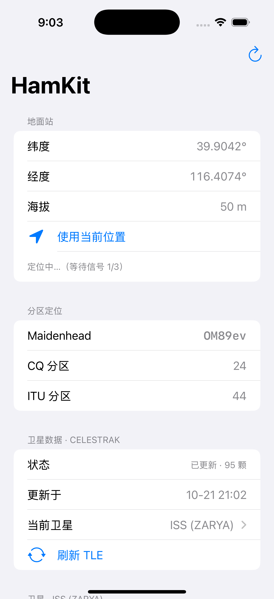
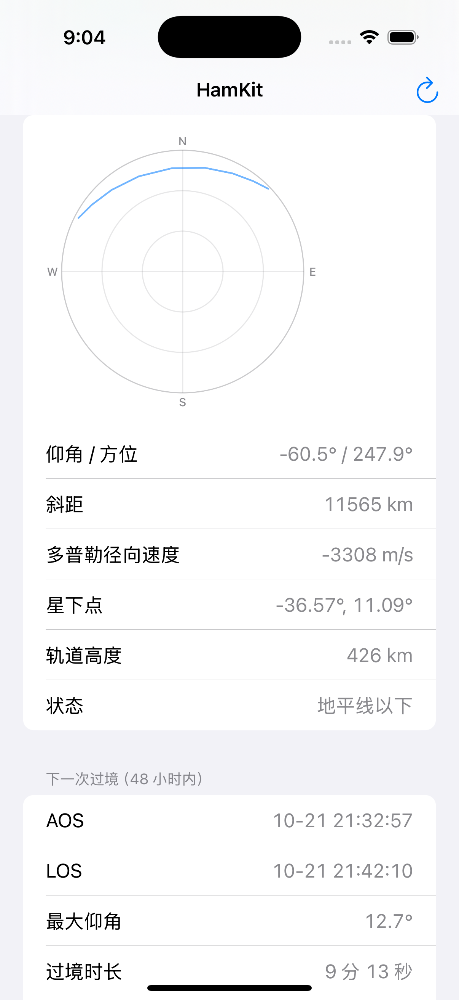

<!--
发布说明（这一段不会显示在论坛里，发帖前删掉本注释块即可）

标题（三选一，填到论坛的标题栏）：
1. HamKit iOS 端开始预热：同一个内核，换了个壳
2. 从「暂时没有 iOS 计划」到「快了」——HamKit iOS 进展汇报
3. HamKit 要上 iPhone 了：不签名，自己签

配图（发帖时手动上传，图片不入库）：
- 首屏截图（地面站 / 分区定位 / 卫星数据）
- 雷达截图（极坐标雷达 + 未来过境）

发布前检查：
[ ] 官方仓库与官网链接可访问
[ ] 还没有下载链接，正文已写明「真机测试通过后在本帖更新」
[ ] 若已有 TestFlight 或 Release 链接，替换文末的「暂时还没有下载链接」一段
-->

之前有朋友在帖子里问："苹果手机没法用吗？"

当时的回答是——"暂时没有 iOS 端的开发计划"。

现在可以改口了。

最近我们把 HamKit 里最核心的那部分，从 Android 代码里抽了出来：分区定位、SGP4/SDP4 轨道计算、过境搜索，做成一份两端共用的内核。也就是说，同一颗卫星、同一个地面站，Android 和 iOS 算出来的过境时间，是同一份代码给的，不会出现"两个手机对不上"这种事。

iOS 端目前跑通了这些：

✅ 一键定位 → CQ Zone / ITU Zone / 6 位梅登海德网格

✅ TLE 自动拉取（走我们自己的 CDN，失败回落 CelesTrak），带本地缓存，断网也能看

✅ 卫星列表，可搜索、可收藏，收藏的排最前

✅ Look4Sat 风格的极坐标雷达，带前后 45 分钟轨迹

✅ 实时仰角 / 方位 / 斜距 / 多普勒径向速度 / 星下点

✅ 未来 48 小时的前 3 次过境，AOS 前 5 分钟本地提醒

下面是刚才在模拟器里跑出来的真实截图（不是效果图）：

还没搬的也很明确：SSTV、FT8、CW、APRS、QSO 日志、地图。会一个一个搬，不一次性堆上来——毕竟我们就几个人，搬快了全是 bug。

说个有点好笑的幕后：整套 iOS 端是在 Windows 上写的。没有 Mac，就用 GitHub Actions 的 macOS 机器编译、装进模拟器、自动截图，我看着截图改界面。所以"没有 Mac 不能开发 iOS"这句话，至少对我们不成立。😄

**但模拟器终究是模拟器。** 接下来会租一台云端 Mac，把包装到真机上跑一遍——定位、通知、断网、后台这些，只有在真机上试过才算数。

**说清楚分发方式：**

iOS 不像 Android，没有开发者账号就上不了 App Store，也开不了 TestFlight。一个 Apple Developer 账号 688 元一年——这个项目没有收入、没有广告，作者自己也掏不起这笔钱。

所以路线是这样，一步一步来：

1️⃣ 租云端 Mac，真机测试（就是现在这一步）

2️⃣ 测完、确认没有低级错误，再把**未签名 IPA** 传到 GitHub Releases 和官网 hamkit.click

3️⃣ 你用 Sideloadly / AltStore 配**自己的 Apple ID** 重签安装；免费账号 7 天续签一次，App 数据不会丢

丑话说在前面：云端 Mac 是按小时租的，只能慢慢来；未签名 IPA 不能双击安装，第一次折腾大概 10 分钟；TrollStore 只支持特定系统版本，不保证你的机器能用。功能本身不打折——本地通知这类能力不需要付费账号，麻烦的只是"装"和"续签"。

**所以暂时还没有下载链接。** 真机测试一过，会在本帖更新，下载地址以官方仓库和官网为准：

- 官方仓库：<https://github.com/fuxue-linkong/HamKit>
- 官方网站：<https://hamkit.click>

想第一批试用的，回个帖；也可以直接说——**你最希望 iOS 端先有哪个功能？** 我们按呼声排。

也提醒一句：只从上面这两个官方地址下载，别用来历不明的"企业证书"重签，证书一被吊销 App 就直接打不开。

如果将来有人愿意赞助一个开发者账号，我们会优先拿它去开 TestFlight，让安装回到"点一下"。

重要的还是那三条：

🆓 完全免费，没有任何广告

📖 代码开源（MIT 协议），欢迎围观 / 改代码 / 提 PR

🤝 纯公益项目，只为方便大家

73！📡
